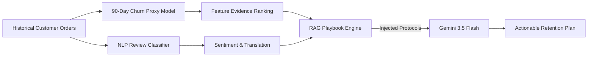

# RetainX: Brazilian E-Commerce Churn Intelligence & Retention Copilot

## Project Report

**Project Type:** Academic Web Application & Machine Learning Prototype  
**Evaluation Date:** 16 November 2026  
**Evaluator:** Manisha Ma'am  
**Target Domain:** E-Commerce Marketplace (Olist Brazilian E-Commerce Dataset)  
**Repository:** RetainX

---

## Executive Abstract

RetainX studies customer inactivity using the **Olist Brazilian E-Commerce Dataset** (~100,000 orders). The main operational rule marks a customer inactive after 90 days without a purchase. For customers below that threshold, an experimental statistical model estimates whether they may cross it before ordering again, using only historical customer signals. Olist has no official churn label. 

The application also includes review sentiment analysis as supplementary context. A sentiment score is inferred from star ratings and is not used to claim permanent churn. Feature evidence explains associations in the data, not causal effects.
---

## 1. Problem Statement & Motivation

In contractual business models (e.g., telecom, SaaS, streaming subscriptions), churn is explicitly observable when a customer cancels their subscription contract. In **non-contractual e-commerce marketplaces**, however, customers do not actively cancel; they simply stop returning. 

In the Olist dataset:
- Approximately **96.9%** of customers place only a single order.
- Only **3.1%** of unique customers return for repeat orders.

Retaining even a modest fraction of high-intent buyers yields significant enterprise value, as acquiring new customers in digital advertising is typically 5x to 7x more expensive than re-engaging past buyers.

The core research and engineering questions addressed by RetainX are:
1. *How accurately can post-purchase operational telemetry (delivery delay, freight cost, transit time) and customer review sentiment predict customer retention in an e-commerce marketplace?*
2. *Which features exert the strongest mathematical leverage on repeat purchase probability?*
3. *How can Large Language Models (LLMs) and RAG provide explainable, domain-grounded customer recovery playbooks while preserving customer privacy and translating foreign-language feedback?*

---

## 2. Dataset Architecture & Pipeline (Olist)

The project utilizes the public **Brazilian E-Commerce Public Dataset by Olist**, consisting of orders placed from 2016 to 2018 across Brazil:

| Table Name | Records | Primary Keys / Foreign Keys | Target Information Extracted |
| :--- | :--- | :--- | :--- |
| `olist_orders_dataset.csv` | 99,441 | `order_id`, `customer_id` | Purchase timestamp, actual delivery date, estimated delivery date |
| `olist_order_items_dataset.csv` | 112,650 | `order_id`, `product_id` | Price ($R\$$), Freight ($R\$$), Item count |
| `olist_order_payments_dataset.csv` | 103,886 | `order_id` | Payment type (credit card, boleto, voucher, debit), Installments |
| `olist_order_reviews_dataset.csv` | 99,224 | `order_id`, `review_id` | Star rating ($1-5$), Review text comment (Portuguese) |
| `olist_customers_dataset.csv` | 99,441 | `customer_id`, `customer_unique_id` | Unique customer identity used for repeat buyer tracking |

### 90-Day Inactivity Target
At prediction time, inactivity days equal the snapshot date minus the last observed purchase date. The operational rule marks a customer inactive at 90 days. For earlier snapshots, the experimental classifier predicts whether the customer will cross 90 days before a new order. Snapshots without complete follow-up are excluded. This is a project-defined proxy, not proof of permanent churn.

---

## 3. Machine Learning Methodology

### 3.1 Feature Engineering
For each customer order, 10 key domain signals are extracted:
1. `delivery_delay_days`: $\max\left(0, \frac{\text{delivered\_customer\_date} - \text{estimated\_delivery\_date}}{86400}\right)$
2. `delivery_duration_days`: $\frac{\text{delivered\_customer\_date} - \text{purchase\_timestamp}}{86400}$
3. `order_value`: Sum of item prices in Brazilian Reais ($R\$$).
4. `freight_value`: Total shipping fee in Brazilian Reais ($R\$$).
5. `freight_ratio`: $\frac{\text{freight\_value}}{\max(1, \text{order\_value} + \text{freight\_value})}$
6. `payment_installments`: Number of credit installments selected.
7. `total_items`: Quantity of items purchased.
8. `payment_type`: Categorical one-hot encoded (credit card, boleto, voucher, debit).
9. `review_score`: Customer rating on an integer scale from $1$ to $5$.
10. `review_has_comment`: Binary flag indicating presence of textual review comment.

### 3.2 Time Windows and Validation
Features are computed only from delivered orders on or before each historical snapshot: recency, order count, tenure, prior spend, review scores, and delivery performance. The next 90 days are used only for the outcome label. A customer-grouped holdout keeps all snapshots for each customer in one partition. Since this is not a future calendar-period test, performance should be treated as historical validation.

### 3.3 Class Imbalance
The target is highly imbalanced: about 99.5% of eligible snapshots cross the inactivity threshold before a new order. The current customer-grouped holdout gives ROC-AUC 0.738 and F1 0.776; a majority-only baseline obtains F1 0.997. Thus the classifier is experimental and not useful at its current threshold. The transparent 90-day rule is the primary churn assessment.

---

## 4. NLP Review Sentiment Engine

- **Corpus:** 37,123 real Portuguese customer reviews extracted from `olist_order_reviews_dataset.csv`.
- **Labels:** 5-star and 4-star reviews are labeled as positive ($Y=1$); 1-star and 2-star reviews are labeled as negative ($Y=0$).
- **Vectorization:** TF-IDF, up to 5,000 unigram and bigram features (minimum document frequency 2).
- **Evaluation:** 20% order-grouped holdout; current run metrics:
  - **ROC-AUC:** 0.974
  - **F1-Score:** 0.952
  - **Precision:** 0.951
  - **Recall:** 0.952
- **Label limitation:** Sentiment is inferred from star ratings (1–2 negative, 4–5 positive), not independently annotated from text.

---

## 5. RAG Architecture & Gemini 3.5 Flash Copilot

RetainX avoids generic hallucinated AI responses by integrating a deterministic **Retrieval-Augmented Generation (RAG)** pipeline:

### RAG Retrieval Protocols (`knowledge_base.py`)
1. **Logistics & Delivery Delay Service Recovery Protocol:** Triggered when `delivery_delay_days > 0`. Outlines automated apologies, freight reimbursement vouchers ($R\$$), and VIP courier priority.
2. **Dissatisfied Buyer & Negative Review Recovery Playbook:** Triggered when `review_score <= 2` or review sentiment is negative. Defines 24-hour CS tier-2 escalation and zero-friction returns.
3. **High Shipping/Freight Cost Mitigation Strategy:** Triggered when `freight_ratio >= 0.20`. Recommends free shipping vouchers and local state-level merchant routing.
4. **Single-Purchase Repurchase Conversion Cadence:** Triggered on all single-order profiles. Outlines timed 7-day, 21-day, and 45-day win-back cadences.
5. **High-Value Account White-Glove Playbook:** Triggered when `order_value >= 500`. Recommends concierge onboarding and loyalty perks.

### Cross-Language Intelligence
Because Olist customer reviews are written in Portuguese (e.g., *"Demorou muito para chegar e a mercadoria veio avariada"*), RetainX instructs Gemini to:
1. Translate the review into fluent English.
2. Extract the operational root cause (logistics failure, product damage, seller responsiveness).
3. Connect the translated root cause directly to the relevant RAG recovery protocol.

---

## 6. Verification and Test Results

All unit and regression tests pass with 100% success rate:
- **`tests/test_app.py`**:
  - `test_home_renders_brand_and_ecommerce_ui`: Verified
  - `test_predict_returns_score_and_feature_evidence`: Verified
  - `test_predict_rejects_non_finite_and_invalid_inputs`: Verified
  - `test_unsupported_industry_returns_bad_request`: Verified
  - `test_missing_model_returns_service_unavailable`: Verified
  - `test_chat_requires_explicit_ai_consent`: Verified
  - `test_chat_preview_is_explicit_when_gemini_api_key_is_missing`: Verified
  - `test_gemini_reply_uses_configured_model_and_returns_generated_text`: Verified
  - `test_review_sentiment_is_analyzed_with_rag_playbook`: Verified
- **`tests/test_training.py`**:
  - `test_feature_groups_do_not_cross_fit_validation_and_holdout_splits`: Verified

---

## 7. Viva & Presentation Checklist for 16th November

- [x] **Single Unified Dataset:** 100k Olist orders with real embedded reviews (no external mismatched datasets).
- [x] **Dual ML Models Trained:** `models/ecommerce.joblib` and `models/reviews.joblib`.
- [x] **Explainable Evidence:** Feature contribution scores computed mathematically via scaled coefficients.
- [x] **RAG Retention Playbooks:** Grounded recovery steps injected into prompt context.
- [x] **Foreign Language Translation:** Automatic Portuguese-to-English review synthesis.
- [x] **Enterprise Dual-Theme UI:** Obsidian Dark & Stripe Crisp Light mode with quick presets.
- [x] **Complete Presentation Defense Guide:** Detailed in [`PRESENTATION_DEFENSE_GUIDE.md`](PRESENTATION_DEFENSE_GUIDE.md).
